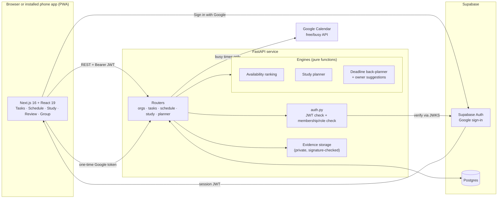
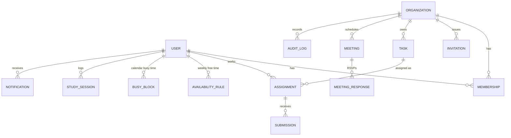

# PLARE architecture

## System overview

## Request flow

1. The user signs in with Google through Supabase Auth, and the browser gets a Supabase session token.
2. Every API call carries that token. `auth.py` verifies it against Supabase's public keys and loads or creates the user.
3. For any group route, `membership()` loads the caller's role from the database. Roles are never read from the request, and data from another group returns 404.
4. Routes load data, call a pure engine function, and return JSON. Engines never touch the database, which keeps them unit-testable.

## The four technical components

| Component | File | Method | What it proves |
| --- | --- | --- | --- |
| Group availability ranking | `api/app/engine/availability.py` | The window is cut into 15-minute steps. Each step holds a bitmask of who is free, and a meeting's attendance is the AND of its steps' masks. Options are ranked by attendance, then flexibility, then soonest. | Finds 15/15 times, then 14/15 alternatives with the names of who's missing. Never counts someone with no data as free. |
| Study planner | `api/app/engine/study.py` | Greedy round-robin across days, taking the longest free chunk each time, with daily caps and breaks, and reporting any shortfall. | Plans a weekly study goal around a person's real calendar. |
| Deadline back-planner + owner suggestions | `api/app/engine/planner.py` | Earliest-deadline-first scheduling into free time, in 30 to 120 minute blocks. Owners are ranked by spare time, meaning free minutes minus assigned work. | Turns a task list into a schedule and flags work that can't fit before its deadline. |
| Google Calendar integration + private evidence | `api/app/routers/schedule.py`, `api/app/routers/tasks.py` | The free/busy scope only, with the token used once and never stored. Uploads are checked by file signature and size and served only to the submitter and reviewers. | Uses real outside data with minimal permissions and keeps photos private. |

## Data model

- Every time is stored in UTC with a timezone. Local time is used only for display and for daily-hours rules.
- `MEMBERSHIP.role` is `admin`, `lead` (brother / PM / team lead), or `member` (pledge / intern / teammate). Each group can label those roles its own way.
- Calendar import stores only busy start and end times, never event titles or attendees.

## Main API routes

| Area | Routes |
| --- | --- |
| Profile and groups | `GET/PATCH /me`, `POST /orgs`, `GET /orgs/{id}/members`, `POST /orgs/{id}/invites`, `POST /invites/{code}/accept` |
| Tasks | `POST /orgs/{id}/tasks`, `GET /orgs/{id}/tasks/mine`, `GET /orgs/{id}/tasks/open`, `POST /tasks/{id}/claim` |
| Submissions and review | `POST /assignments/{id}/submissions`, `GET /orgs/{id}/review`, `POST /submissions/{id}/review`, `GET /submissions/{id}/file` |
| Scheduling | `PUT /availability/me`, `POST /calendar/sync`, `GET /orgs/{id}/best-times`, meetings and RSVP |
| Study | `POST /orgs/{id}/study/{start,pause,resume,end}`, `GET /orgs/{id}/study/plan`, `GET /orgs/{id}/study/group-times` |
| Planner | `GET /orgs/{id}/plan/mine`, `GET /tasks/{id}/suggest-owners`, `POST /tasks/{id}/assign` |

FastAPI serves interactive docs for every route at `/docs` on the running API.

## Testing

36 backend tests cover the engines, permissions (cross-group access, role escalation, private files), upload validation, and the full submit → review → approve flow. They pass on both SQLite and Postgres (`TEST_DATABASE_URL=... pytest`). The frontend is type-checked, linted, and built on every change.
